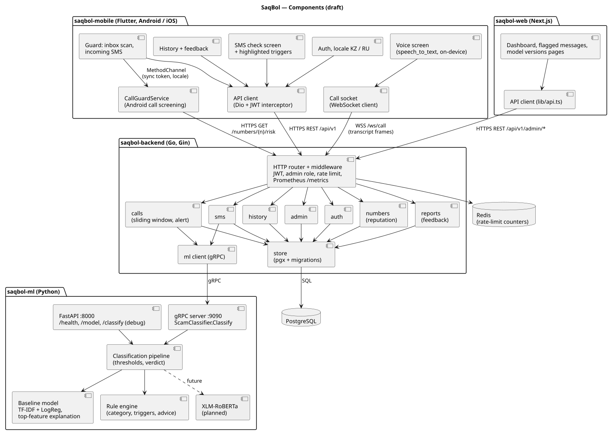

# SaqBol

**SaqBol** (*сақ бол*, Kazakh for "stay alert") is a research prototype for detecting fraudulent
SMS and telephone calls in **Kazakh and Russian**. It classifies message/transcript text and
provides a risk verdict, category, matched trigger phrases where available, and advice.
Kazakh live-speech recognition is a project target, not a verified capability: the current
mobile speech path requests the Russian locale. [Implementation and evidence status](docs/implementation-evidence.md).

Diploma project, Software Engineering

## Problem

Internet and phone fraud is about one in five registered crimes in Kazakhstan: 28.9 thousand cases
in 2025. The most common scheme is a call or message in the name of a bank
([sources](docs/02-relevance-evidence.md#21-published-statistics-for-kazakhstan)). Existing
protection differs in its use of number reputation, message/call content, language support and
regional availability ([comparison](docs/04-existing-systems-comparison.md)). The reviewed sources
do not establish a sufficiently large, documented corpus of authentic Kazakh/Russian fraud SMS
for this project's evaluation; a published 189-message pilot does exist
([literature review](docs/03-literature-review.md)).

**Target users:** people in Kazakhstan who receive SMS and calls in Kazakh and/or Russian,
especially older people and the relatives who help them; administrators who monitor detection
quality.

**Expected outcomes:** a working mobile app + backend + ML service + web dashboard; a corpus of
real Kazakh/Russian scam messages; an experimental comparison of a TF-IDF baseline and a
fine-tuned XLM-RoBERTa on real data; a real-time call-analysis pipeline with measured latency.

## Team

| Member | Responsibilities |
|---|---|
| **Danial Myrzatayev** (SE-2412) | Team lead; backend (Go); ML service and experiments; infrastructure and CI; architecture and documentation |
| **Asylbek Abdibay** (SE-2427) | Mobile app (Flutter) features; web dashboard; user research and usability testing; real-data collection; device testing; code review |

**Supervisor:** Zhibek Nurzhanovna Sarsenova

## Links

- **YouTrack:** [project SAQ](https://saqbol.youtrack.cloud/issues/SAQ) · [Kanban board](https://saqbol.youtrack.cloud/agiles/204-1/current)
- **Documentation:** [docs/](docs/README.md): proposal, relevance evidence, literature review,
  system and technology comparisons, requirements, architecture, prototype, verification plan,
  project management, supervisor feedback
- **Diagrams:** [diagrams/](diagrams/README.md), PlantUML sources and SVG/PNG exports

## Scope

**In scope:** classification of SMS text (Kazakh, Russian, mixed) into safe / suspicious / scam,
with category, trigger phrases and advice; sender-number reputation; Android inbox scan, incoming-SMS
check and call screening; live call analysis via speakerphone and the OS speech-recognition service;
feedback and history; Kazakh/Russian interface; admin web dashboard.

The app sends recognised text to the SaqBol backend. The OS recogniser may use a remote service;
the implementation does not enforce offline recognition. Kazakh text classification and a Kazakh
interface must be assessed separately from Kazakh speech recognition.

**Out of scope:** intercepting call audio, automatic SMS reading on iOS, voice deepfakes, messengers,
integration with real banks or operators, blocking messages or calls.
Details: [proposal §1.6](docs/01-project-proposal.md#16-scope).

## Status (October 2026)

| Part | Status |
|---|---|
| Backend: auth, SMS check (single and batch), reputation, feedback, history, admin, WebSocket call stream | ✅ implemented |
| ML: TF-IDF + LogReg baseline with rule engine (gRPC + REST) | ✅ implemented; XLM-RoBERTa planned |
| Mobile: SMS check, guard, live call analysis, message history | Prototype code available; speech uses `ru_RU` in `main`; Kazakh speech and physical-device behavior remain unverified |
| Web dashboard: metrics, flagged messages, model versions | ✅ implemented |
| Data in the reviewed `main` baseline | 2,248 rows: 2,020 template examples + 184 student-project examples + 44 team-authored seeds. The 228 original examples are not verified received SMS |
| ML branch data | 4,457 rows after adding 2,209 deduplicated English translations; separate, unmerged snapshot ([versions](docs/implementation-evidence.md#dataset-provenance-and-versions)) |
| Detection quality on real received SMS | Not established. The reported 0.511 recall is an exploratory result on the 228 course/seed examples, not real-world recall ([details](docs/09-verification-plan.md#93-current-baseline)) |
| User interviews / client agreement | Not yet supplied; the interview guide is preparation, not completed user evidence |
| Supervisor feedback | Not yet supplied; the feedback log is awaiting a substantive review |

## Architecture



Clients talk only to the backend. The backend calls the ML service over gRPC.

| App | Stack | Purpose |
|---|---|---|
| [`saqbol-backend`](saqbol-backend) | Go, Gin, pgx, Redis, gRPC, JWT | REST + WebSocket API, business logic, number reputation |
| [`saqbol-ml`](saqbol-ml) | Python, scikit-learn, FastAPI, gRPC; Transformers (XLM-R, planned) | Scam classifier (KZ/RU) and explanation |
| [`saqbol-mobile`](saqbol-mobile) | Flutter, Riverpod, Dio, Kotlin (Android call screening) | SMS check, protection, live call analysis |
| [`saqbol-web`](saqbol-web) | Next.js, TypeScript, Tailwind, Recharts | Admin dashboard |
| Data | PostgreSQL, Redis | Persistent data; rate limiting |
| Ops | Docker Compose, Kubernetes / k3s, GitHub Actions | Deployment and CI |

Why these technologies: [technology comparison](docs/05-technology-comparison.md).

## Quick start

Requirements: Docker Desktop running (`docker info` succeeds).

```bash
git clone https://github.com/DanialMyrzatayevMuratovich/saqbol.git
cd saqbol
cp .env.example .env          # set JWT_ACCESS_SECRET, JWT_REFRESH_SECRET, POSTGRES_PASSWORD
docker compose up -d --build  # postgres, redis, ml, backend, web
```

| Service | URL |
|---|---|
| Web dashboard | http://localhost:3000 |
| Backend API | http://localhost:8080 (health: `/health`, metrics: `/metrics`) |
| ML service (debug) | http://localhost:8000/health |

Smoke test (register, then check a scam SMS end to end):

```bash
until curl -sf http://localhost:8080/health >/dev/null; do sleep 2; done
B=http://localhost:8080/api/v1
TOKEN=$(curl -s -X POST $B/auth/register -H 'Content-Type: application/json' \
  -d '{"phone":"+77000000001","password":"secret123","name":"Demo"}' \
  | python3 -c 'import sys,json;print(json.load(sys.stdin)["access_token"])')
curl -s -X POST $B/sms/check -H "Authorization: Bearer $TOKEN" -H 'Content-Type: application/json' \
  -d '{"text":"Служба безопасности банка, назовите код из смс","source_number":"+77770001100"}'
```

Expected: `"verdict":"scam"` with `"model_version":"baseline-tfidf-logreg-v1"`.

Admin pages need an admin user: set `ADMIN_PHONES` in `.env` to the registered phone and run
`docker compose up -d backend`.

Stop: `docker compose down` (add `-v` to wipe the database).

### Mobile app

```bash
cd saqbol-mobile
flutter pub get
flutter run --dart-define=API_BASE_URL=http://10.0.2.2:8080          # Android emulator
flutter build apk --dart-define=API_BASE_URL=http://<LAN_OR_SERVER_IP>:8080
```

More: [saqbol-mobile/README.md](saqbol-mobile/README.md). Other deploy paths:
[k8s/README.md](k8s/README.md) (minikube), [k3s/README.md](k3s/README.md) (single VPS).

## Tests

```bash
cd saqbol-backend && go test ./...
cd saqbol-ml && python -m venv .venv && source .venv/bin/activate \
  && pip install -r requirements-dev.txt && python -m pytest -q
cd saqbol-mobile && flutter test
cd saqbol-web && npm install && npm test
```

ML evaluation: `cd saqbol-ml && python training/evaluate.py` (writes to `saqbol-ml/experiments/`).
The full test and evaluation plan is in [docs/09-verification-plan.md](docs/09-verification-plan.md).

## Repository layout

```
saqbol-backend/   Go API (cmd/, internal/, proto/)
saqbol-ml/        ML service (app/), training/, data/, tests/, experiments/
saqbol-mobile/    Flutter app (lib/, android/, ios/, test/)
saqbol-web/       Next.js dashboard (src/)
docs/             Analysis and design documents
diagrams/         PlantUML sources (src/) and exports (export/)
k8s/, k3s/        Kubernetes manifests and deploy scripts
.github/          CI workflow, pull request template
```

## Contributing

Every change is linked to a YouTrack task: branch `SAQ-<id>-<slug>`, commit `SAQ-<id>: …`,
pull request into `main` reviewed by the other team member. See
[project management](docs/10-project-management.md#102-tools-and-workflow).

Secrets (`.env`, tokens, keys) are never committed; use `.env.example` with placeholder values.
