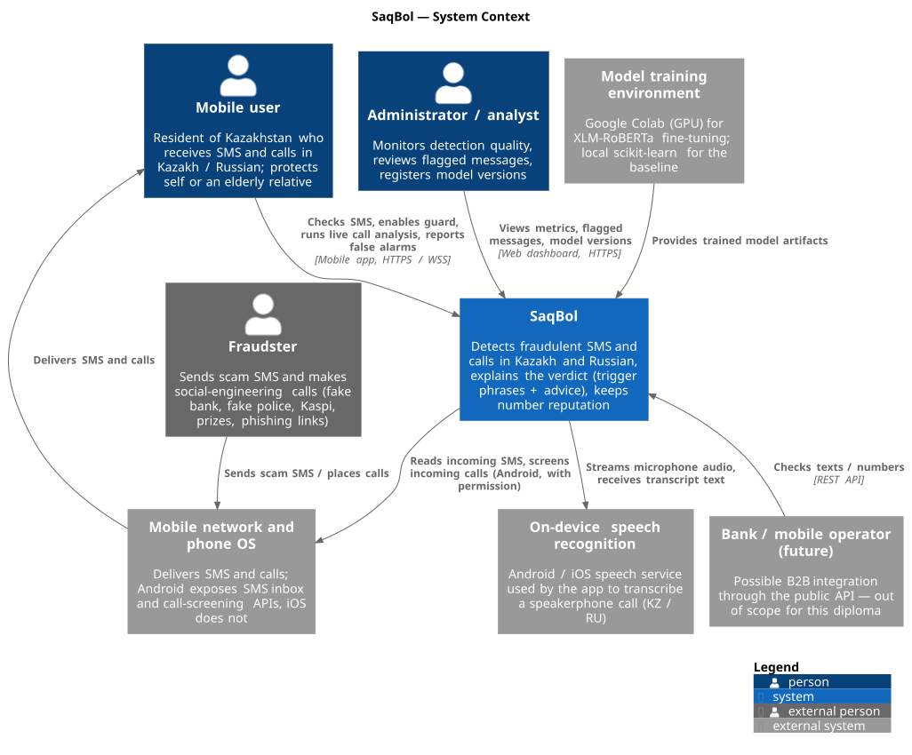
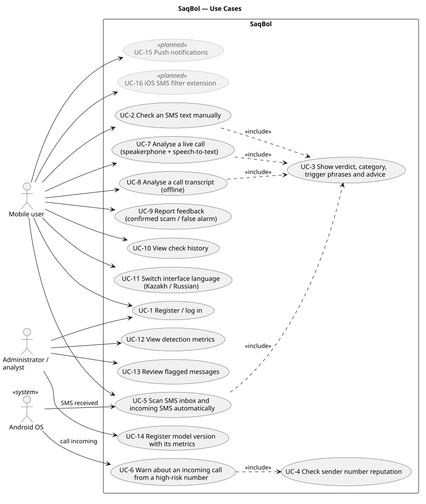
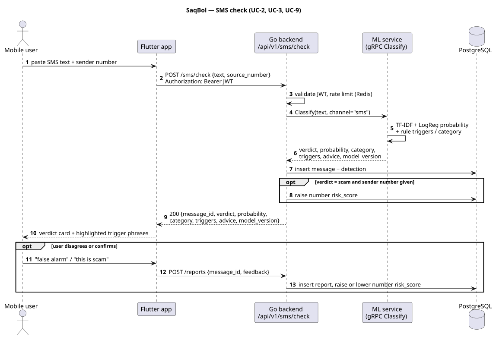
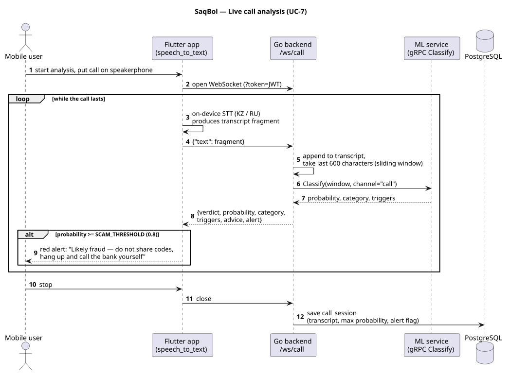
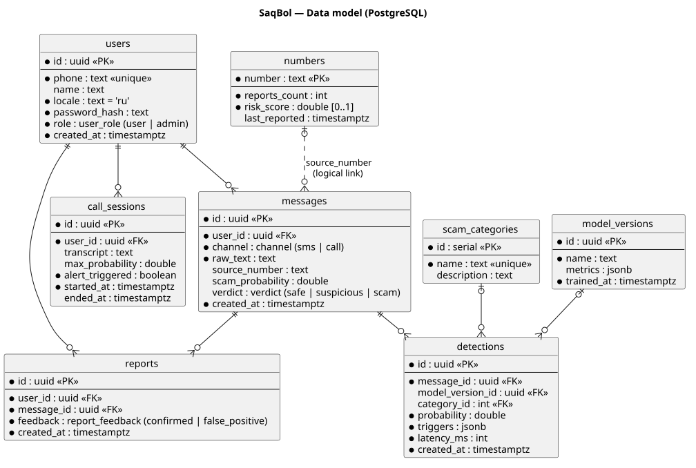

# 7. Architecture

The diagrams are written in PlantUML. Editable sources are in [`diagrams/src/`](../diagrams/src),
and SVG and PNG exports are in [`diagrams/export/`](../diagrams/export).
To regenerate the exports, see [`diagrams/README.md`](../diagrams/README.md).

Implementation statements below refer to `main` at `91862dc`. A source-code path is not
evidence of a successful device test; see [implementation evidence](implementation-evidence.md)
for the distinction between current code, changes under review and planned validation.

## 7.1 System context

SaqBol sits between the user and the channels fraudsters use (SMS and voice calls).
It never touches the cellular network itself. On Android it reads the SMS inbox and screens
incoming calls through official OS APIs, with the user's permission; device verification is pending.
For live calls the mobile app delegates recognition to the OS speech service and requests
`ru_RU`. It sends final transcript text to the SaqBol backend. The code does not enforce
local-only recognition, so the speech provider may process audio outside the phone. Kazakh
speech recognition is a target, not an implemented or verified capability. Model training is
outside the running system: local scikit-learn supplies the baseline artifacts, while
Google Colab fine-tuning for XLM-RoBERTa remains a research plan in this snapshot.

## 7.2 Use cases

Grey use cases are planned (FR-7, FR-17 remote push). The main scenarios are UC-2 (manual SMS
check) and UC-7 (live call analysis). Both include UC-3 (explanation), which is the core value of
the product: the user sees *why* a message is dangerous.

## 7.3 Components

| Component | Responsibility | Code |
|---|---|---|
| **Mobile app** | UI for SMS check, guard, live call analysis, checked-SMS history; Android integration (SMS inbox, `CallScreeningService`); OS speech recognition requesting `ru_RU`, with processing location unverified | `saqbol-mobile/lib/src/features/*`, `android/.../CallGuardService.kt` |
| **Web dashboard** | Admin pages: metrics, flagged messages, model versions | `saqbol-web/src/app/*` |
| **Backend router and middleware** | JWT auth, admin role check, Redis rate limit, Prometheus metrics, routing | `saqbol-backend/internal/httpserver` |
| **auth** | Register, login, refresh tokens; bcrypt password hashes | `internal/auth` |
| **sms** | Single and batch SMS check; stores message and detection; raises number risk on scam | `internal/sms` |
| **calls** | WebSocket stream, sliding window (last 600 chars), alert flag, call session; offline transcript analysis | `internal/calls` |
| **numbers / reports / history / admin** | Reputation lookup, user feedback, history, admin metrics and model versions | `internal/*` |
| **ml client** | gRPC client to the ML service; a mock classifier for tests | `internal/ml` |
| **store** | PostgreSQL access (pgx) and embedded migrations | `internal/store` |
| **ML gRPC server** | `ScamClassifier.Classify` / `ClassifyStream` | `saqbol-ml/app/grpc_server.py`, `proto/ml/v1/ml.proto` |
| **Classification pipeline** | Combines model probability and rule score, applies thresholds, builds verdict, category, triggers, advice | `saqbol-ml/app/classifier/pipeline.py` |
| **Baseline model** | TF-IDF + Logistic Regression; top-weighted n-grams as explanation | `app/classifier/baseline.py` |
| **Rule engine** | Category patterns, explicit triggers in Kazakh and Russian (e.g. "код из смс", "қауіпсіздік қызметі", look-alike domains such as `kaspii.kz`), advice texts | `app/classifier/rules.py` |

### Interfaces

| Interface | Protocol | Contract |
|---|---|---|
| Mobile / web → backend | HTTPS REST, JSON, `/api/v1/*` | See [prototype API examples](08-prototype.md#82-api-examples) |
| Mobile → backend, live call | WebSocket `/ws/call?token=…`, JSON frames `{"text": …}` → `{verdict, probability, category, triggers, advice, alert}` | `internal/calls/handler.go` |
| Backend → ML | gRPC, Protocol Buffers | `saqbol-backend/proto/ml/v1/ml.proto` |
| Backend → PostgreSQL / Redis | SQL (pgx) / Redis protocol | migrations in `internal/store/migrations` |

HTTPS/WSS are the deployment target. The documented local demo uses HTTP/WS and VPS TLS is
still pending; the protocol labels are not evidence that encrypted transport has been deployed.

## 7.4 Key scenarios

**SMS check (UC-2, UC-3, UC-9)**

**Live call analysis (UC-7)**

The sequence describes the implemented transcript path, not a completed real-call test.
The app can also send manually entered fragments. Neither a Kazakh text fragment nor a
Kazakh UI locale demonstrates Kazakh speech recognition; PR #20 at `f361a8f`, still under
review at this audit, also selects `ru_RU` for the Kazakh UI.

## 7.5 Data model

- `messages` stores checked SMS in the current write path. `detections` stores their model
  output: probability, category, triggers, latency. Although the schema permits a `call`
  channel, the current call handlers do not create message/detection rows.
- `call_sessions` separately stores analysed call transcripts, maximum probability and the
  alert flag. `/api/v1/history` reads `messages` through `Messages.ListByUser`; it does not
  return `call_sessions`. Stored calls are therefore not visible in the current history UI.
- `numbers` is the crowd-sourced reputation. It is linked to `messages.source_number` logically,
  not with a foreign key, because a number can be scored before anyone checks a message from it.
- `model_versions` and `detections.latency_ms` support the experiments chapter of the thesis.

## 7.6 Deployment

| Environment | How | Notes |
|---|---|---|
| Local / demo | `docker compose up -d --build` — postgres, redis, ml, backend, web | Postgres and Redis are not exposed on the host; ports 3000 / 8080 / 8000 |
| Kubernetes (minikube) | `k8s/deploy.sh` | Separate deployments and services per component |
| Single VPS (k3s) | `k3s/deploy.sh` | HTTP over IP; TLS is a pending task (NFR-3) |

CI (`.github/workflows/ci.yml`) builds and checks all four apps on every push.

## 7.7 Architectural decisions

| # | Decision | Rationale |
|---|---|---|
| AD-1 | Clients talk only to the backend; the ML service is internal | One place for auth, rate limiting and persistence; the ML service can be replaced or scaled independently |
| AD-2 | gRPC between backend and ML | Typed cross-language contract and low overhead ([5.2](05-technology-comparison.md#52-backend--ml-service-communication)) |
| AD-3 | One classifier for SMS and call transcripts | Both are short-text classification; the `channel` field lets us specialise later |
| AD-4 | Delegate speech recognition to the OS service; send transcript text to SaqBol | Avoids implementing an audio/STT server. It does not guarantee local-only audio processing; privacy and language validation remain open ([5.5](05-technology-comparison.md#55-speech-to-text-for-live-call-analysis)) |
| AD-5 | Model probability combined with a rule engine (`max` of both) | Rules keep recall on known local patterns while real data is scarce; the model generalises beyond the rules |
| AD-6 | Planned final evaluation: authentic held-out messages; synthetic/translated material excluded from the final test set | This is an evaluation policy, not a claim about completed experiments. Authenticity, provenance and split independence must be established (see [verification plan](09-verification-plan.md)) |

## 7.8 Alignment check

| Use case | Requirements | Components | Data |
|---|---|---|---|
| UC-1 Register / log in | FR-15, NFR-4 | auth, store | users |
| UC-2 Check SMS | FR-1, FR-5 | mobile SMS screen → sms → ml client → ML pipeline | messages, detections |
| UC-3 Explanation | FR-2, FR-3 | ML pipeline (baseline explain + rules), mobile highlighted text | detections.triggers, scam_categories |
| UC-4 / UC-6 Number reputation, call warning | FR-4, FR-20 | CallGuardService → numbers | numbers |
| UC-5 Inbox / incoming SMS scan | FR-6, FR-17 | mobile guard → sms (batch) | messages, detections |
| UC-7 Live call | FR-9 … FR-12, FR-14, NFR-1 | mobile voice + OS STT (`ru_RU` requested; Kazakh pending) → calls (WS) → ML | call_sessions |
| UC-8 Offline transcript | FR-13 | calls (REST) → ML | call_sessions |
| UC-9 Feedback | FR-8, FR-4 | mobile SMS verdict card → reports | reports, numbers |
| UC-10 History | FR-16 | history (checked SMS only; call history pending) | messages, detections |
| UC-11 Language | FR-18 | mobile locale storage | device storage; `users.locale` set at registration |
| UC-12 … 14 Admin | FR-19 | web → admin | messages, detections, model_versions |

### Known gaps found during this review

- Kazakh speech recognition is not configured. Russian speech recognition, real-call audio
  access, recognition latency and the speech provider's processing location still require
  device evidence; no local-only audio-processing guarantee is established.
- Call sessions are stored separately and are not exposed by the current history endpoint/UI.
- `detections.model_version_id` is never filled: the backend does not yet map `model_version`
  from the ML response to a `model_versions` row.
- `FR-13` accepts a transcript only; audio upload is not implemented.
- The original draft (`SaqBol_TZ.md`) mentions NestJS, pgvector and object storage. The
  implementation uses Go, and has neither pgvector nor object storage yet. This document
  describes the actual system.
