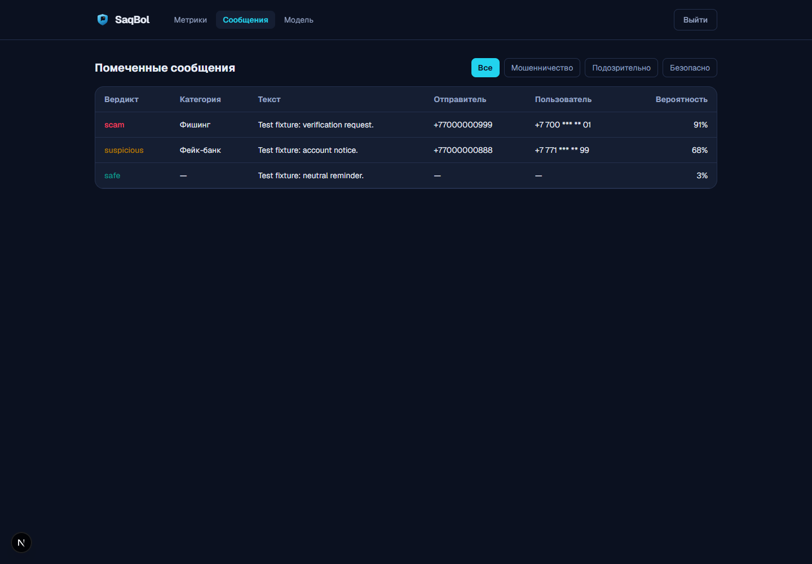

# SAQ-62 — masked user phone numbers

Task: [SAQ-62](https://saqbol.youtrack.cloud/issue/SAQ-62).

The Messages table now displays a complete user number such as `+77001234501` as
`+7 700 *** ** 01`. Common spaced, parenthesised, hyphenated and domestic `8` formats
produce the same result. Unsupported or incomplete values display `—`; they never
fall back to the raw input. Sender numbers remain unchanged for reputation checks.

## Evidence

- [Browser assertions](browser-check.json): three invented rows cover a complete number,
  a formatted number and an unsupported value. The expected User and Sender cells were
  checked, and raw user values were absent from the DOM and its attributes. No page errors
  or unexpected external requests were recorded. The preview server was stopped.
- Chrome 146.0.7680.165, 1440 × 1000 viewport, local Next.js preview. Browser requests
  were intercepted with test fixtures: no real account, backend or user messages were used.
- The screenshot was visually inspected. The dummy sender values shown in full are test
  fixtures, not participant contact details.
- `npm run lint`, `npm test` (14 tests, including 12 masking cases), and
  `npm run build -- --webpack` passed on 24 October 2026. Validation uses an isolated
  copy of the tracked web source and the existing matching dependencies; all 33 tracked
  web files were compared byte for byte. No dependency or lockfile changes are included.

## Scope and limitation

This is display masking in the User column. The backend response and browser memory still
contain the full user number. It does not establish complete compliance with NFR-3 or
server-side data minimisation. Any backend response change needs a separately agreed API task.
